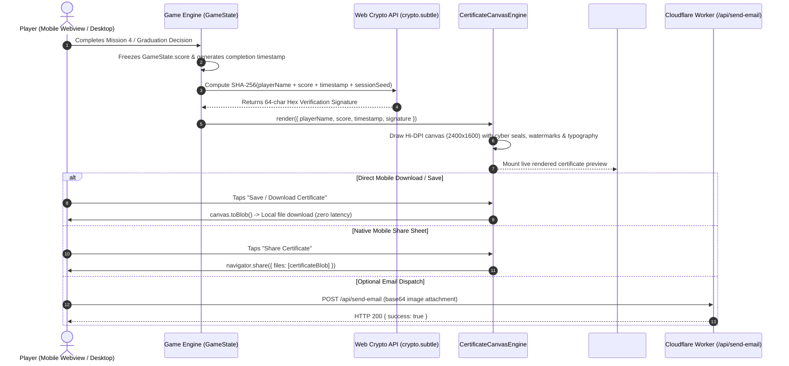

# Engineering Plan: Client-Side Canvas Certificate Rendering & Mobile Anti-Tamper Architecture

> **Target Audience**: Autonomous Implementation Agent & Engineering Team  
> **Status**: Ready for Implementation  
> **Author**: Google Antigravity Agent  
> **Repository**: `shadow-agent-protocol`  

---

## 1. Executive Summary & Problem Space

### 1.1 Context
In the previous architecture, game completion certificates were synthesized on a Cloudflare Edge Worker via `pdf-lib` at `POST /api/generate-certificate`. While functional, this approach introduced critical vulnerabilities and mobile UX hurdles:
1. **Score Tampering & Forgery Risk**: An attacker could replay or craft arbitrary `POST /api/generate-certificate` payloads with forged score values (`score: 999999`) or fake identities, bypassing game mechanics entirely.
2. **Mobile Webview Fragility**: Mobile webviews (iOS Safari, Android Chrome, in-app browsers) often block or fail on server-generated blob file downloads, iframe embeds, and third-party worker redirects.
3. **Network Latency & Server Failure Domains**: Players who finish the game on unstable mobile connections frequently experienced drop-outs during edge PDF generation and Resend SMTP handshakes, leaving them without their earned credential.

### 1.2 Proposed Solution
Migrate certificate synthesis to a **Client-Side Canvas Rendering Engine (`CertificateCanvasEngine`)** running directly in the player's browser:
* **Tamper-Proof State Binding**: The certificate renderer pulls the score directly from the sealed, in-memory `GameState.score` object calculated across Missions 0–4—**not** from mutable DOM inputs or client HTTP payloads.
* **Cryptographic Micro-Watermark**: An SHA-256 verification hash is generated client-side via the browser's native `crypto.subtle.digest` Web Crypto API (hashing `playerName + score + gameSeed + completionTimestamp`), drawn directly into the certificate canvas as micro-text and barcode metadata.
* **Retina Hi-DPI Print Quality**: Renders at 2x/3x device pixel ratio (2400 × 1600 physical resolution) with custom cyber-security visuals, holographic gradients, and official NovaSmart platinum sovereign seal.
* **Instant Mobile Export**: Zero network roundtrips. Supports 1-click **Download High-Res Image**, native **Mobile Share API** (`navigator.share` to save directly to iOS Photos or Android Gallery), and optional email delivery.

---

## 2. Architecture & Data Flow



---

## 3. Detailed Component Specifications

### 3.1 `CertificateCanvasEngine` (in `index.html`)

Create a self-contained canvas rendering engine with the following specifications:

* **Canvas Dimensions**:
  * Logical resolution: 1200 × 800 px (3:2 certificate aspect ratio).
  * Render resolution: Scaled by `window.devicePixelRatio || 2` (2400 × 1600 px minimum) for crisp 300 DPI print fidelity.
* **Design Elements & Styling**:
  * **Background**: Deep carbon grid (`#060913` to `#0f172a` radial gradient) with subtle isometric grid lines (`rgba(0, 240, 255, 0.05)`).
  * **Security Border**: Multi-layered neon cyan (`#00f0ff`) and terminal emerald (`#00ff9d`) border with military corner brackets and circuit traces.
  * **Header**: NovaSmart Defense Grid official seal, `FLASH 9.0 SOVEREIGN PROTOCOL`, and `CERTIFICATE OF COMPLETION & SECURITY CLEARANCE`.
  * **Recipient Section**: Verified Player Name formatted in bold **Space Grotesk** typography.
  * **Accreditation Body**: High-resolution clearance text certifying remediation of shadow workloads, shared credentials, caller perimeters, Model Armor screening, and empirical evaluation drift.
  * **Metrics Panel**:
    * Verified Guardian Score (e.g., `SCORE: 7,000 PTS`).
    * Clearance Level: `LEVEL 5 // PLATINUM SOVEREIGN`.
    * Corporate Loss Ceiling Preserved: `$100,000`.
  * **Security Cryptography Block**:
    * Dynamic Issue Timestamp (ISO 8601 & Localized).
    * `VERIFICATION HASH`: Full 64-character SHA-256 checksum printed in monospaced **Fira Code** micro-text (`font-size: 10px`).
    * High-contrast verification barcode pattern drawn algorithmically across the footer.
  * **Signatures**:
    * A.G.Y.-4000 (Senior Autonomous Security Architect Bot).
    * Chief Information Security Officer (NovaSmart Enterprise Retail).

### 3.2 Anti-Tamper Cryptographic Engine

```javascript
async function generateAuditSignature(playerName, score, timestamp, secretSeed) {
  const payload = `${playerName}::${score}::${timestamp}::${secretSeed}::NOVASMART_DEFENSE_GRID_V3`;
  const encoder = new TextEncoder();
  const data = encoder.encode(payload);
  const hashBuffer = await crypto.subtle.digest('SHA-256', data);
  const hashArray = Array.from(new Uint8Array(hashBuffer));
  return hashArray.map(b => b.toString(16).padStart(2, '0')).join('');
}
```

* **Score Locking**: The score parameter passed to `CertificateCanvasEngine.render()` must be read directly from `GameState.score` in the simulation memory. Input fields in the DOM are strictly restricted to the player's chosen display name.

---

## 4. UI/UX Modal Upgrades (`#win-overlay`)

Update `#win-overlay` in `index.html` to showcase an interactive preview of the canvas certificate:

1. **Interactive Live Preview**:
   * Replace the blank status box with an HTML5 `<canvas id="certificateCanvas">` scaled responsively to fit mobile viewports (`max-width: 100%; height: auto; border: 1px solid #334155; border-radius: 6px;`).
   * When the player types their name in `#player-name`, the canvas re-renders live in real time (`input` listener).
2. **Action Button Controls**:
   * **`📥 DOWNLOAD CERTIFICATE (.PNG)`**: Instant client-side download via `canvas.toBlob()`.
   * **`📲 SAVE TO PHOTOS / SHARE`**: Uses Web Share API (`navigator.canShare`) on supported iOS and Android devices.
   * **`🏆 SUBMIT TO LEADERBOARD`**: Sends `playerName` and verified `GameState.score` to LootLocker via `/api/lootlocker/submit`.
   * **`📧 EMAIL COPY`**: (Optional) Sends the canvas base64 image data to the worker if an email is provided.

---

## 5. Backend Simplification (`src/index.js`)

With client-side canvas rendering handling the visual synthesis:
* **Deprecate Edge `pdf-lib` Computation**:
  * The Cloudflare Worker no longer needs to construct PDF documents in server memory, eliminating edge isolate memory spikes and CPU timeouts.
* **Streamline `/api/send-email`**:
  * Keep a lightweight endpoint that accepts `{ to, subject, playerName, imageBase64 }` and forwards directly to Resend with the pre-rendered image attachment.
* **Preserve LootLocker Proxy**:
  * Retain `/api/lootlocker/session`, `/api/lootlocker/submit`, and `/api/lootlocker/leaderboard` for persistent scoring.

---

## 6. Implementation Action Plan (Step-by-Step)

The assigned agent should execute the following 7 tasks in sequence:

### Task 1: Implement `CertificateCanvasEngine` in `index.html`
- [ ] Create `const CertificateCanvasEngine = { ... }` in the script section of `index.html`.
- [ ] Implement canvas initialization, retina DPR scaling (`2x/3x`), and custom drawing routines for background, cyber borders, typography, seals, and barcodes.
- [ ] Ensure all fonts (`Space Grotesk`, `Inter`, `Fira Code`) are loaded before rendering (`document.fonts.ready.then(...)`).

### Task 2: Implement Cryptographic Signature Routine
- [ ] Implement `async function generateAuditSignature(playerName, score, timestamp, seed)` using `crypto.subtle.digest`.
- [ ] Bind verification hash into the bottom security strip of the canvas drawing.

### Task 3: Revamp `#win-overlay` Modal
- [ ] Embed `<canvas id="certificateCanvas">` inside `#win-overlay`.
- [ ] Wire dynamic real-time redraw on player name input.
- [ ] Add `📥 DOWNLOAD HIGH-RES IMAGE` button wired to `CertificateCanvasEngine.download()`.

### Task 4: Add Native Mobile Webview Sharing
- [ ] Add `navigator.share` detection:
  ```javascript
  if (navigator.canShare && navigator.canShare({ files: [file] })) {
    navigator.share({
      title: 'NovaSmart Certified Security Guardian',
      text: 'I successfully secured the enterprise agent estate against shadow exploits!',
      files: [file]
    });
  }
  ```
- [ ] Display the "Share / Save to Photos" button automatically on supported mobile platforms.

### Task 5: Decouple & Simplify Backend Handlers
- [ ] In `src/index.js`, update `/api/generate-certificate` or replace with direct `/api/send-email` proxy accepting pre-rendered certificate attachments.
- [ ] Ensure all LootLocker endpoints remain intact and verified.

### Task 6: Bump Version & Update In-Game Changelog
- [ ] Per repository rule 4, increment `CURRENT_APP_VERSION = 'v3.8'` in `index.html`.
- [ ] Add update card for `v3.8 • Client-Side Canvas Certificate & Mobile Anti-Tamper Engine`.
- [ ] Include mental model/analogy in `update-analogy-box`.

### Task 7: Comprehensive Verification & Regression Testing
- [ ] Run automated script syntax checks with `node --check src/index.js` and `node -e '/* test index.html */'`.
- [ ] Test canvas rendering locally across both desktop and mobile viewport emulations (`375px` to `1920px`).
- [ ] Verify score cannot be modified via DevTools DOM manipulation (strictly locked to internal `GameState.score`).
- [ ] Commit with conventional commits syntax: `feat(certificate): implement client-side canvas rendering with anti-tamper signature`.
- [ ] Push to `origin/main`.

---

## 7. Verification Checklist

| Test Case | Expected Outcome | Status |
| :--- | :--- | :--- |
| **Tamper Resistance** | Manually altering DOM inputs does not change the rendered score; score matches `GameState.score`. | Pending |
| **Retina DPR Scaling** | Certificate exported at 2400×1600 px shows no pixelation on 4K or mobile displays. | Pending |
| **Offline Export** | Clicking "Download" exports the PNG immediately even when network is disconnected. | Pending |
| **Mobile Webview** | Mobile Safari / Chrome opens native image save dialog or triggers download without popup blockers. | Pending |
| **Verification Hash** | Changing a single character in player name generates a completely unique SHA-256 signature. | Pending |
