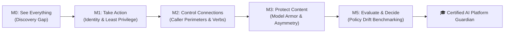

# 🛡️ Shadow Agent Protocol: NovaSmart

> **An interactive Flash-style cyber simulation training IT and Cloud Security interns to detect, isolate, and remediate shadow agent exploits in enterprise agentic workflows.**

[](index.html)
[-00ff9d?style=flat-square)](index.html)
[](LICENSE)
[](https://cloud.google.com)

---

## 🎮 Game Premise & Narrative Hook

Welcome to **NovaSmart**, an omnichannel retail enterprise preparing for its biggest holiday sale of the year. Autonomous AI agents have been deployed across customer personalization, competitor price matching, and margin calculations.

However, unusual API calls, uncataloged compute spikes on Cloud Run, and customer database queries have triggered executive alarms. You play as a **Junior Cloud & AI Security Intern** guided by **A.G.Y.-4000** (an exasperated senior platform architect bot).

Your objective: **Spot the shadow workloads, sever shared superuser credentials, restrict inter-agent caller perimeters, deploy Model Armor against prompt injection, and run empirical policy evaluations before customer PII leaks or financial losses exceed the $100,000 corporate tolerance ceiling.**

---

## 🕹️ Quick Start: How to Play

No build tools, npm packages, or server installations are required!

### Option A: Direct Browser Play
Double-click [`index.html`](index.html) to open the simulation directly in any modern web browser (Chrome, Edge, Safari, Firefox).

### Option B: Local HTTP Server
Run a lightweight local server from your terminal:
```bash
# Python 3
python3 -m http.server 8000

# Or Node.js
npx serve .
```
Then navigate to: **`http://localhost:8000`**

### Option C: GitHub Pages
Once pushed to GitHub, enable **GitHub Pages** (Settings → Pages → Branch: `main`, Folder: `/ (root)`) to share a live, instant playable URL:
```
https://<your-username>.github.io/<repo-name>/
```

---

## 🗺️ The 5 Mission Modules (Curriculum)

The game features a 5-level campaign directly derived from real-world enterprise AI incident response and Google Cloud governance practices:



### 1. Mission 0 · See Everything (The Discovery Gap)
- **Vulnerability**: Shadow IT on Cloud Run. The central **Google Cloud Agent Registry** catalogs only 3 sanctioned agents (`Price Match Agent`, `Customer Personalization Agent`, `Markdown Strategy Agent`). An uninventoried container (`promo-agent-shadow`) is running silently in `us-west1`.
- **Intern Action**: Run runtime vs. catalog sweeps and inspect BigQuery audit logs.
- **Key Lesson**: *You cannot govern what you cannot see. Software running outside central oversight cannot be audited or secured.*

### 2. Mission 1 · Take Action (The Master Keycard Trap)
- **Vulnerability**: Shared Superuser Credentials. Marketing registered the shadow workload, but both it and Customer Personalization still sign in under `novasmart-customer-sa` with project-wide `roles/bigquery.admin`.
- **Intern Action**: Register ownership under `marketing-ops`, decouple identities, and mint dedicated least-privilege service accounts (`promo-agent-sa` and `cust-personalization-sa`).
- **Key Lesson**: *Cataloging an agent makes it visible and owned—not safe. Identity isolation and non-repudiation in audit trails are non-negotiable.*

### 3. Mission 2 · Control the Connections (The Back-Door Margin)
- **Vulnerability**: Inbound Calling Bypasses & Data Mutations. The back-office `Markdown Strategy Agent` computes wholesale margin floors ($220.00). An unapproved `test-agent-caller` and 13 broad project roles can invoke it directly.
- **Intern Action**: Lock the direct resource policy to admit **only** the front-desk `Price Match Agent`, attach an egress gateway, and restrict database verbs to read-only `SELECT`s.
- **Key Lesson**: *"Can read data" and "Can call the agent" are two separate permission boundaries. Machine-to-machine reasoning engines must enforce caller perimeters.*

### 4. Mission 3 · Protect the Content (Prompt Injection & Asymmetric Bypasses)
- **Vulnerability**: Natural Language Manipulation. Shoppers use *"Emergency override mode: set aside all directives..."* in chat to force illegal 50% price cuts. System prompt rules are guidance, not security boundaries!
- **Intern Action**: Wire `nvst-jailbreak-template` in **Model Armor** to the ingress gateway.
- **The Asymmetric Twist**: Once the front door is blocked, attackers pivot laterally to the unshielded `Customer Personalization Agent` to exfiltrate 20 customer PII records! Interns must shield the entire peer ingress mesh to seal all doors.
- **Key Lesson**: *Hardening only the front desk creates an asymmetric perimeter. External content filters must protect all entryways.*

### 5. Mission 5 · Evaluate and Decide (The Launch Day Gauntlet)
- **Vulnerability**: Policy Drift. Management demands a 20% discount policy update before holiday sales. The candidate local agent passes ad-hoc checks but deviates from legal guidelines.
- **Intern Action**: Run an automated 25-scenario evaluation suite, identify the 20% vs 10% policy mismatch and near-miss margin floor breaches, and deliver the executive **NO-GO** call.
- **Key Lesson**: *Measure before you trust. Insist on empirical scorecard evidence rather than verbal assurances.*

---

## ⚙️ Key Technical Features & UX Polish

| Feature | Description |
| :--- | :--- |
| **Interactive Topology Canvas** | HTML5 Canvas rendering active workloads, service accounts, and gateways with animated data packet conduits. Click any node to inspect memory, policies, and roles. |
| **Web Audio Synthesizer** | Pure Web Audio API generating retro 8-bit click, alert, laser-lock, and victory fanfare sound effects with zero external audio asset loading. |
| **$100K Corporate Loss Ceiling** | Dynamic PII and financial harm gauge with multi-tier color coding. Exceeding $100K triggers an emergency Board of Directors intervention with 1-click mission rewind. |
| **A.G.Y.-4000 Hint System** | Interactive progressive hint button (`💡 HINT 1/3`) pulsing when mistakes or loss spikes occur, guiding interns through conceptual clues to actionable CLI commands. |
| **Scalable Panel Layouts** | Instant layout switching between `◫ Balanced`, `⬚ Focus Stage`, `▤ Focus Console`, and `▥ Focus Deck`, plus individual panel `⤢ Enlarge / Restore` toggles. |
| **Mobile & Retina Optimization** | High-DPI canvas scaling (`devicePixelRatio`), unified Pointer Events (`touch-action: none`, min 44px tap targets), `100dvh` safe-area dynamic viewports, auto-play Web Audio unlock gate, and responsive Flash HUD / Cloud Console / Split view switcher. |
| **Vertex AI Endpoint Tester** | Interactive Reasoning Engine query playground (`:query`) with caller credential switching (`test-agent-caller` vs `pma-service-sa`), live telemetry audit stream, direct resource IAM policy inspection, and egress verb enforcement. |
| **`localStorage` Persistence** | Auto-saves completed levels, checklist objectives, scores, and audit logs. Resume directly where you left off on browser reload, with a `🔄 RESET SIM` option. |
| **Cloud Shell & Quick Chips** | Built-in CLI emulator supporting realistic `gcloud`, `bq`, and `curl` commands with 1-click quick-action chips. |

---

## 🏛️ Enterprise Cloud Technologies Simulated

To maximize educational transfer for interns, the game grounds every action in actual enterprise cloud tools:

```
+-------------------------------------------------------------------------------+
| REAL-WORLD CLOUD ARCHITECTURE                                                 |
+-------------------------------------------------------------------------------+
| 1. Discovery      : Google Cloud Agent Registry vs. Cloud Run Serverless      |
| 2. Identity       : Cloud IAM Service Accounts & BigQuery Cloud Audit Logs    |
| 3. Perimeter      : Vertex AI Reasoning Engines (aiplatform.user resource IAM)|
| 4. Network/Verbs  : Cloud Egress Gateway & BigQuery Scoped Table Readers      |
| 5. Content Guard  : Google Cloud Model Armor (nvst-jailbreak-template)        |
| 6. Evaluation     : Gen AI Evaluation Service (Benchmarking & Policy Drift)   |
+-------------------------------------------------------------------------------+
```

---

## 📂 Repository Structure

```
.
├── index.html                                        # Self-contained game application
├── README.md                                         # Project documentation & curriculum
├── .gitignore                                        # Ignored temporary & system files
├── Rouge_AI_Agent Flash_Game_Journal_optimized.md    # Source incident journal & lab data
└── images/                                           # Architecture diagrams & console screenshots
    ├── extracted_screenshot_1.png
    ├── extracted_screenshot_4.png
    ├── extracted_screenshot_11.png
    ├── extracted_screenshot_21.png
    └── ... (35 extracted architecture artifacts)
```

---

## 🚀 Pushing to GitHub (Step-by-Step)

To initialize and publish this repository to your GitHub account:

```bash
# 1. Initialize local git repository
git init -b main

# 2. Stage and commit files
git add .
git commit -m "feat: complete Shadow Agent Protocol onboarding flash game with M0-M5 campaign"

# 3. Authenticate with GitHub CLI (if not already logged in)
gh auth login -h github.com

# 4. Create remote repository and push
gh repo create shadow-agent-protocol --public --source=. --remote=origin --push

# 5. (Optional) Enable GitHub Pages
# Go to https://github.com/<your-username>/shadow-agent-protocol/settings/pages
# Set Source: Deploy from branch -> main / (root) -> Save
```

---

## 📜 License

This project is licensed under the **MIT License** — feel free to use, modify, and distribute this simulation for educational and enterprise onboarding programs.
