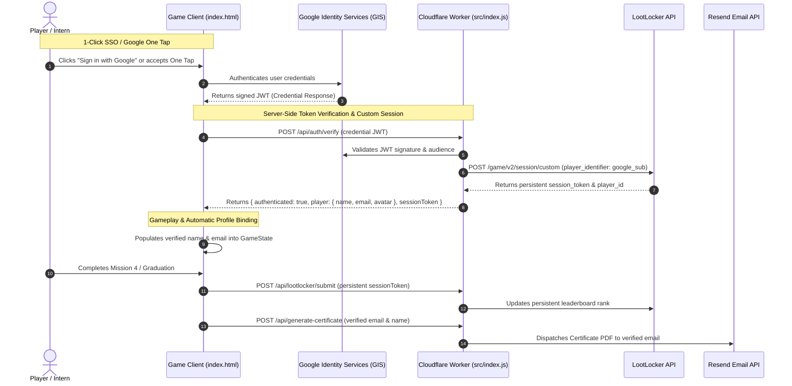

# Implementation Plan: OAuth / SSO Authentication & Persistent Identity

Transition the **Shadow Agent Protocol** from ephemeral anonymous guest sessions to a **unified 1-Click OAuth / SSO authentication flow** (Google One Tap & OAuth 2.0 / GitHub SSO), automatically binding persistent user profiles to LootLocker custom sessions and certificate delivery.

---

## User Review Required

> [!IMPORTANT]
> **Google Cloud & OAuth Client ID Setup Required**:
> Full OAuth authentication requires registering an **OAuth 2.0 Client ID** in Google Cloud Console (`APIs & Services > Credentials > OAuth client ID`) with authorized JavaScript origins:
> - `https://iramirez016.github.io`
> - `https://shadow-agent-protocol.iramirez-b6a.workers.dev`
> - `http://localhost:8000` / `http://localhost:8787` (for local development)
>
> We will design the implementation with a **graceful fallback**: if `GOOGLE_CLIENT_ID` is not yet configured or blocked by third-party cookies, the game seamlessly offers a standard 1-click modal or guest mode so gameplay and testing are never blocked.

> [!NOTE]
> **Progressive Authentication (Zero Drop-Off Architecture)**:
> Rather than a blocking login gate before Mission 0 (which causes bounce rates), we employ **Progressive Profiling**:
> 1. Players can start Mission 0 immediately or sign in with 1 click via the retro titlebar.
> 2. Signing in automatically extracts and verifies the player's Google profile (`name`, `email`, `picture`).
> 3. LootLocker is initialized via `https://api.lootlocker.com/game/v2/session/custom` using the verified Google unique ID (`sub`) as `player_identifier`, ensuring persistent player identity across game replays, devices, and browser restarts.

---

## Proposed Architecture & Data Flow



---

## Open Questions

> [!WARNING]
> 1. **Primary OAuth Provider Preference**: Google Identity Services (Google One Tap + Sign in with Google) provides the lowest friction (1-click on mobile & desktop). Would you like to add GitHub SSO as a secondary option for the cybersecurity/developer theme?
> 2. **Session Persistence**: Do you prefer storing the verified player session in `localStorage` so returning players on the same browser stay logged in across sessions? (Recommended: Yes).

---

## Proposed Changes

### Cloudflare Worker Backend (`src/index.js`)

#### [MODIFY] `src/index.js`
- **Add `/api/auth/verify` Endpoint**:
  - Accepts Google JWT credential token from client.
  - Validates token against Google's tokeninfo endpoint (`https://oauth2.googleapis.com/tokeninfo?id_token=...`).
  - Provisions a persistent LootLocker session via LootLocker Custom Session (`https://api.lootlocker.com/game/v2/session/custom`) with `player_identifier = google_sub`.
  - Sets player name automatically in LootLocker to the verified Google display name.
  - Returns authenticated user payload (`name`, `email`, `picture`, `session_token`, `player_id`).
- **Support Custom Session in `/api/lootlocker/session`**:
  - Accept optional `player_identifier` so authenticated users receive their unique LootLocker record, while anonymous users fallback to guest sessions.

```javascript
// --- OAuth: Verify Google ID Token & Link LootLocker Custom Session ---
if (url.pathname === '/api/auth/verify' && request.method === 'POST') {
  try {
    const { idToken } = await request.json();
    if (!idToken) {
      return new Response(JSON.stringify({ error: 'Missing idToken' }), {
        status: 400,
        headers: { ...corsHeaders, 'Content-Type': 'application/json' }
      });
    }

    // Verify token with Google's public validator
    const gRes = await fetch(`https://oauth2.googleapis.com/tokeninfo?id_token=${encodeURIComponent(idToken)}`);
    if (!gRes.ok) {
      return new Response(JSON.stringify({ error: 'Invalid Google ID token' }), {
        status: 401,
        headers: { ...corsHeaders, 'Content-Type': 'application/json' }
      });
    }
    const profile = await gRes.json();
    const { sub, email, name, picture } = profile;

    // Start persistent LootLocker session linked to Google sub
    const llRes = await fetch('https://api.lootlocker.com/game/v2/session/custom', {
      method: 'POST',
      headers: { 'Content-Type': 'application/json' },
      body: JSON.stringify({
        game_key: env.LOOTLOCKER_API_KEY,
        game_version: '1.0.0',
        player_identifier: `g_${sub}`
      })
    });
    const llData = await llRes.json();
    const sessionToken = llData.session_token;

    // Synchronize verified display name with LootLocker
    if (sessionToken && name) {
      await fetch('https://api.lootlocker.io/game/player/name', {
        method: 'PATCH',
        headers: {
          'Content-Type': 'application/json',
          'x-session-token': sessionToken,
          'LL-Version': '2021-03-01'
        },
        body: JSON.stringify({ name })
      });
    }

    return new Response(JSON.stringify({
      authenticated: true,
      player: { sub, email, name, picture },
      sessionToken,
      playerId: llData.player_id
    }), {
      status: 200,
      headers: { ...corsHeaders, 'Content-Type': 'application/json' }
    });
  } catch (err) {
    return new Response(JSON.stringify({ error: err.message }), {
      status: 500,
      headers: { ...corsHeaders, 'Content-Type': 'application/json' }
    });
  }
}
```

---

### Game Frontend (`index.html`)

#### [MODIFY] `index.html`
- **Include Google Identity Services SDK**:
  - Add `<script src="https://accounts.google.com/gsi/client" async defer></script>`.
- **Titlebar User Badge / SSO Trigger**:
  - Add a sleek retro cyber SSO button in the titlebar (`<div id="authProfileWidget">`):
    - When logged out: Shows `🔑 SIGN IN (GOOGLE)` button.
    - When logged in: Shows player avatar, verified name, and `✓ VERIFIED INTERN` badge.
- **Automatic One Tap & Promptless Login**:
  - When the page loads, Google One Tap seamlessly prompts existing Google users in the top-right corner.
  - Automatically loads saved profile from `localStorage` if authenticated.
- **Zero-Friction Score & Certificate Flow**:
  - When the player completes the game, their name and email are **pre-filled and locked as verified**:
    - No manual typing required.
    - 1-click **"SUBMIT VERIFIED SCORE & EMAIL CERTIFICATE"**.
  - Direct download and leaderboard update happen instantly with zero drop-off.
- **In-Game Changelog Update**:
  - Bump `CURRENT_APP_VERSION = 'v3.8'`.
  - Add update card for `v3.8 • 1-Click Google OAuth & Persistent Player Identity`.

---

### Configuration & Deployment (`wrangler.jsonc`)

#### [MODIFY] `wrangler.jsonc`
- Add configuration metadata note for `GOOGLE_CLIENT_ID` in environment bindings.

---

## Verification Plan

### Automated Tests
1. **Endpoint Validation via Node script**:
   ```bash
   node -e '
   import("./src/index.js").then(async ({ default: worker }) => {
     // Test missing token
     const req = new Request("http://localhost/api/auth/verify", {
       method: "POST",
       headers: { "Content-Type": "application/json" },
       body: JSON.stringify({})
     });
     const res = await worker.fetch(req, {});
     console.log("Empty token status:", res.status); // Expect 400
   });
   '
   ```
2. **Syntax and Linter Validation**:
   ```bash
   node --check src/index.js
   node -e '/* test index.html script tag parsing */'
   ```

### Manual Verification
1. Open `index.html` locally and verify:
   - Retro titlebar displays the `🔑 SIGN IN` button without layout distortion.
   - Google One Tap initializes cleanly without throwing unhandled exceptions.
2. Sign in with Google:
   - Titlebar updates to show player's name and avatar.
   - Leaderboard fetches against the persistent LootLocker account.
3. Complete Mission 4 (or trigger `showDiplomaModal()`):
   - Victory modal displays verified player name and email automatically.
   - Submitting score immediately records under the player's persistent identity on the LootLocker dashboard.
4. Verify non-authenticated / guest fallback continues to function without errors if a player chooses not to sign in.
